# ReelShare — Offline Video Studio


An Android editor for making your own short videos without an account or backend. Built with Kotlin, Jetpack Compose, Dagger Hilt, Room, Media3 and WorkManager.

## Use it

1. Tap **Create a reel** or the floating **New reel** button. If a draft is waiting, **Continue a draft** opens your saved projects.
2. Choose **Create reel** to use the device camera, or **Import MP4**.
3. Open **All editing tools** (grid icon) for Trim, Frame, Adjust, Looks, Speed, Text, Motion, Clips, Collage, Captions, Audio and Details. In Audio, add a device audio file or use sound from a local MP4; choose the excerpt from its waveform, set its volume and optionally mute the original. Switch to Voiceover to record a take and choose its position in the reel. Then tap **Export**.
4. **Create preview** renders to cache and adds it to your personal Reels screen.
5. **Save to device** renders if necessary and saves an MP4 in **Download/ReelShare**. Find it under **Studio menu → Saved videos** or in your Files app.

For a split frame, choose **Video layouts / collage** from the create sheet. Start with two columns, two/three rows or a four-cell grid, then record or add media into each saved cell. You can also pick 2–4 photos/videos together. Change layout, spacing, cell order/crop and original audio in **Collage**. Up to three 1080p videos play together (two on Android low-RAM devices); the remaining cells can be photos. Fill every cell before exporting.

The feature list and limits below describe the app. Full Instagram or CapCut feature parity is not claimed.

Imports become drafts immediately after the copy completes. Edit decisions save automatically to Room. Open **Studio menu → Drafts** to resume. The original remains untouched. Open Profile from the home header to set a local photo, display name and bio.

The app contains no sample videos, other users, likes, follows, comments or sharing. Internet access is used only for an explicitly requested caption-language model download. Video and audio are processed locally; there is no backend, account, upload, analytics or music API.

## Features

- MP4 imports up to 512 MB, 10 minutes and 4K frame dimensions. Recording requests a 90-second limit from the external camera app.
- Video layouts with 2–4 photo/video cells, individual crop/position, spacing, reordering and original-sound selection. Empty layouts save as drafts and block export until filled.
- Trim with a minimum one-second source selection; speed changes can produce shorter output. Sources over 30 seconds offer a 5/15/60-second close-up filmstrip for either boundary plus 0.1-second nudges; single-video drafts and timeline clips use the same controls.
- Brightness, contrast, saturation and warmth with a heading-level reset. Four color looks plus Original have video-thumbnail swatches, an explained strength control and Before/After comparison.
- Reel-wide constant speed from 0.25× to 4× with pitch preservation, or a bounded 24-step start-to-end ramp. Splitting a ramped clip keeps the original progression across both pieces, including later trims. A selected timeline clip can override that pace with its own constant speed.
- Up to 8 timed text overlays: four offline fonts (Manrope Bold/Simple, Serif and Typewriter), illustrated Classic/Shadow/Outline/Label styles, size/color, rotation with reset, and drag positioning on the video. The Animate tab offers None, Fade, Pop and Slide with a 100–800 ms entrance/exit length and **Play from text start**. Tap a title or **Position on video** to pause within its timing. A drag saves one undo step; text decisions persist in Room and apply to preview and export. Rotated overlays scale and clamp inside the output frame; editing guides are never exported.
- Two-point zoom/pan keyframes with linear or smooth easing, plus picture fade in/out. The info button opens an animated guide and an optional gentle-zoom example.
- Up to 12 MP4 clips / 10 minutes of source selection: reorder, trim, split, duplicate and remove clips. Each clip can have its own 0.25–4× speed, 0–100% original sound level, and drag/zoom crop. Frame reset returns it to the reel crop; speed/sound reset returns it to the reel pace and full sound. Splitting keeps at least one second of source on each side and requires a constant pace for that clip. Cut, fade-through-black and fade-through-white transitions.
- Zoomable thumbnail timeline with a fixed playhead: drag to scrub, hold a clip to reorder (keep it near an edge to scroll through longer reels), and use the selected clip's speed, sound, crop and source-filmstrip trim controls. The selected clip opens at its midpoint so its frame can be positioned directly in the preview. Audio, titles and captions share the final output clock; tap a title/caption to open its controls. Thumbnail decoding is serialized off the UI thread with a small cache.
- Undo/redo in the editor header, saved with the draft in Room across app restarts. Up to 20 steps within a 256 KB recipe/history budget; nearby text keystrokes coalesce into a step.
- Reusable visual styles saved in Room (up to 30); styles exclude footage, title text and speed decisions.
- English/Hindi automatic captions using Vosk on-device. First use explicitly downloads a SHA-256-verified language model (40–45 MB), retained for offline use. Background progress and Cancel; originals never leave the device.
- Import/export SRT, edit caption words/times and apply a caption style to the whole reel. Up to 192 captions; review recognition accuracy. Captions can highlight Yellow, Blue or White words as they play. On-device recognition stores each spoken word's timestamp across clip trims/speed changes; imported SRT and captions whose wording was edited use an estimated reading pace. The Animate tab labels which timing is in use. SRT export contains line timing and words, not animation or word styling.
- Original, 9:16, 1:1, 4:5 and 16:9 frames. In Frame, drag the video to choose the crop and use Zoom up to 2×. The same bounded frame is used by preview and MP4 export; Reset frame restores the center.
- Small / Balanced / High compression: approximately 1.5 / 3 / 6 Mbps, with 480 / 720 / 1080 short-edge targets. No source upscaling; even dimensions and a bounded long edge. Low-RAM devices use a smaller target.
- H.264/AAC MP4 output, up to 30 fps, optional original-audio removal and HDR-to-SDR conversion where the device supports it.
- Offline music import through the system document picker: audio up to 64 MB / 30 minutes; sound from a local MP4 up to 512 MB / 30 minutes. Supported formats depend on Android's decoders.
- Real decoded audio waveforms with accessible excerpt handles, one-second music nudges, volume and original-sound mixing. Music starts at reel time zero and stops at its selected end; no looping or extending the video.
- Up to four voiceover takes alongside music: foreground microphone recording, source trim, reel offset, per-take volume, removal and durable undo/redo. Closing the recorder or backgrounding stops and saves a valid take; discard and recordings under one second do not add a track. Recording pauses preview to avoid speaker feedback. Takes stop at the reel end; originals and source selections remain available after a shorter trim.
- Waveform decoding runs off the UI thread, one decoder at a time, retaining 256 peaks per source in a small memory cache with cancellation and a 30-second deadline. If unavailable, audio handles remain usable.
- Music and individual voiceover fade in/out, up to 5 seconds each and capped at half the part that actually plays. Fades follow source selection and the reel end; seeks and replay retain their timing.
- Optional music ducking with adjustable reduction (70% by default), a smooth 150 ms lead-in and 350 ms recovery. Music lowers during voiceover take timing, including pauses, and overlapping takes do not multiply the reduction. Takes at 0% volume or outside the reel are ignored. Original video sound stays unchanged; speech/silence detection is not implemented.
- Music title, artist and embedded artwork when present, plus searchable recently used audio from existing drafts. Each draft owns its imported copy.
- Editor preview and export use the same Media3 composition. Reel name/notes and title edits do not rebuild the decoder. Stable text-overlay slots update while playing or redraw the paused frame. Other visual edits are committed after sliders settle, and graph updates are debounced while preserving the playhead. The rendered reel feed retains hold-right-for-2× playback.
- Adaptive editor layout with a larger, expandable preview with a stable video buffer, a centered selected tool in the icon toolbar, scrollable controls and export in the header. Back collapses the expanded preview before leaving the editor. Ramp speeds have their own reset; quick constant-speed presets stay in Constant mode.
- Preview recovery with a Retry action and a 15-second progress watchdog while playback is requested. Collage loops hold a small captured frame during graph recreation when available. Pause/play follows the requested state and shows buffering progress; fully seamless collage replay remains open.
- Foreground export notifications with progress and Cancel. Jobs run serially and retry once at a smaller size after a codec export failure.
- Persistent drafts and profile metadata in Room; migration preserves videos made in the former local-feed version.
- Vertical playback of your own rendered reels. Tap to pause without a pause icon; hold the right half for 2× and release for normal speed.
- Blue and neutral visual system with bundled Manrope typography, an original vector mark, adaptive icon and system-aware splash. Android 12+ animates the R mark on launch without an artificial wait; earlier versions use the static mark.
- Light / Dark / System appearance, persisted in Room. Change it from **Studio menu → Appearance**.
- One main studio workspace, a floating create action, libraries and appearance in the studio menu, and Profile in the header. No bottom navigation bar.
- The starting screen gives creation or draft resumption priority, shows the real saved-draft count, and introduces the available tools.
- Portrait-only phone activity; wider windows retain a centered workspace (see platform limits below).

| Light studio | Dark studio | Editor |
| --- | --- | --- |
| 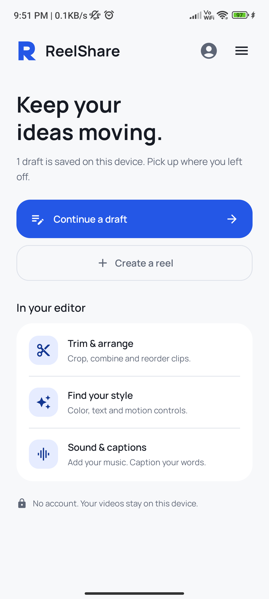 | 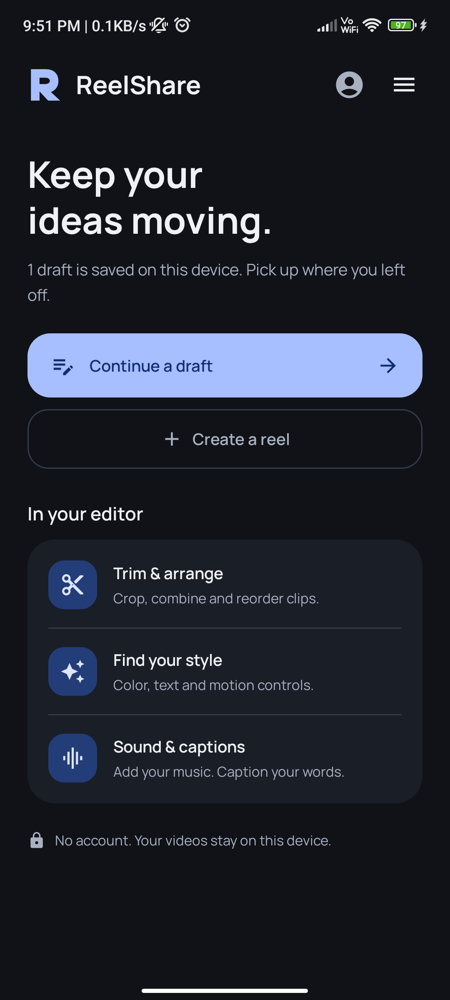 | 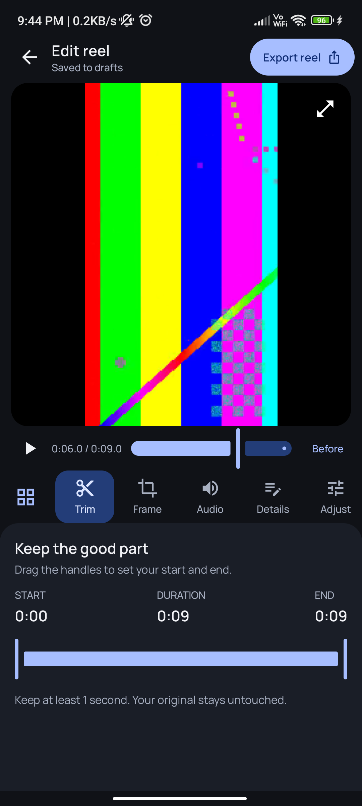 |

| Studio menu | Saved videos | Profile |
| --- | --- | --- |
| 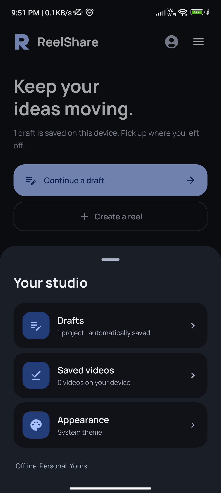 | 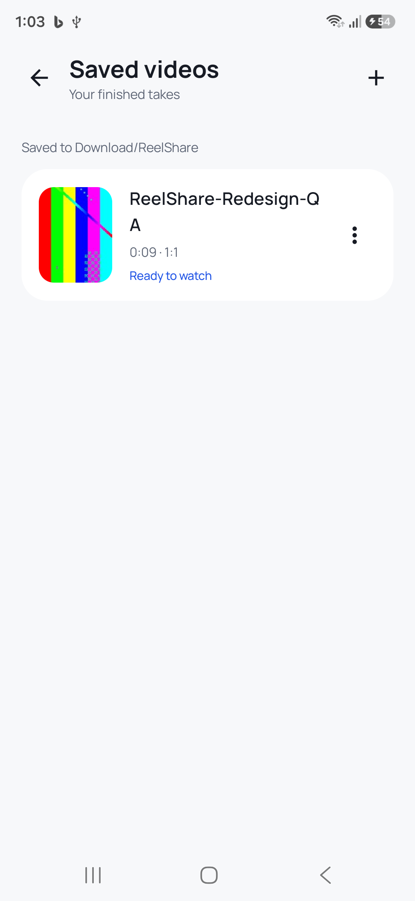 | 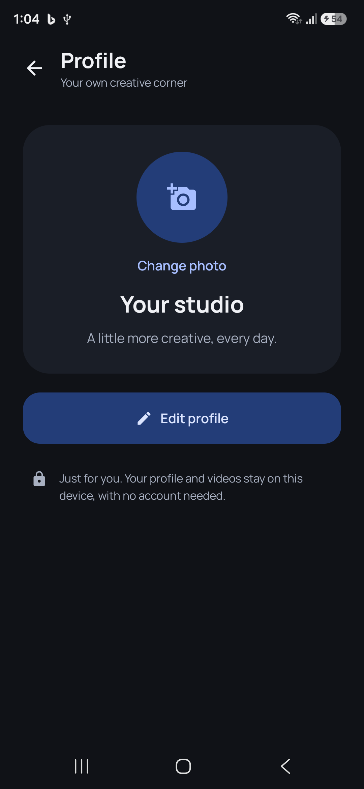 |

<details>
<summary>Filmstrip timeline · light and dark</summary>

| Light timeline | Dark timeline |
| --- | --- |
| 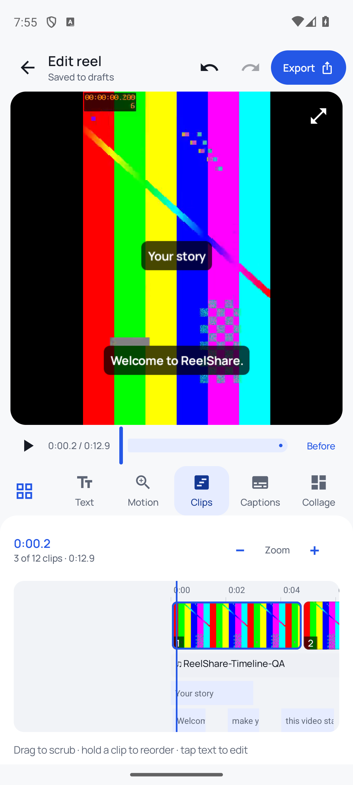 | 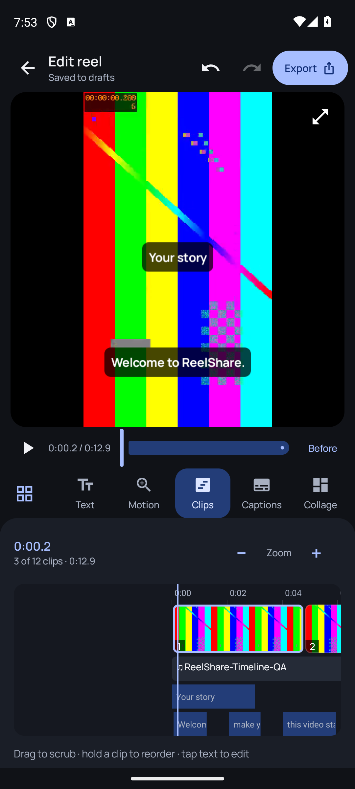 |

</details>

<details>
<summary>Music picker · light and dark</summary>

| Light | Dark |
| --- | --- |
| 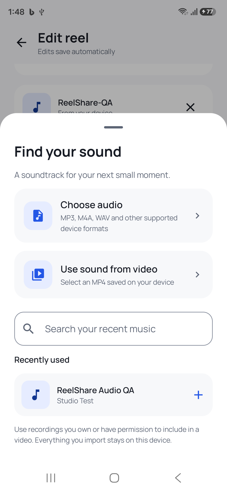 | 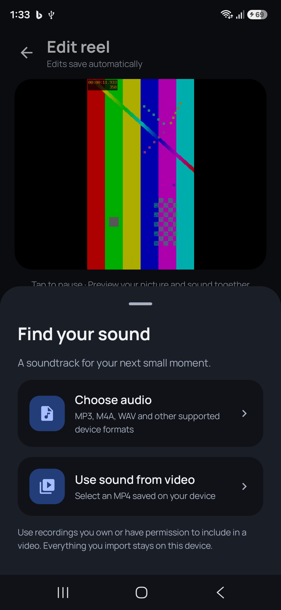 |

</details>

<details>
<summary>Editing tools and offline captions</summary>

| All tools | Caption editing |
| --- | --- |
| 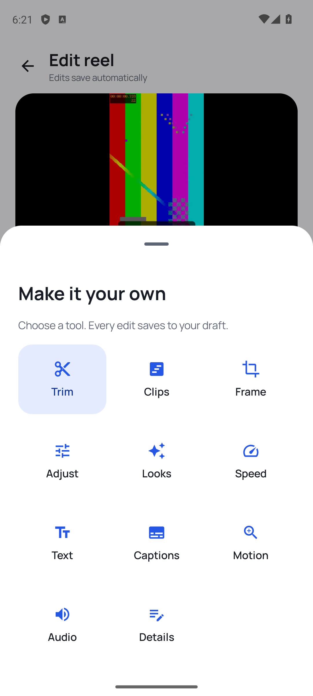 | 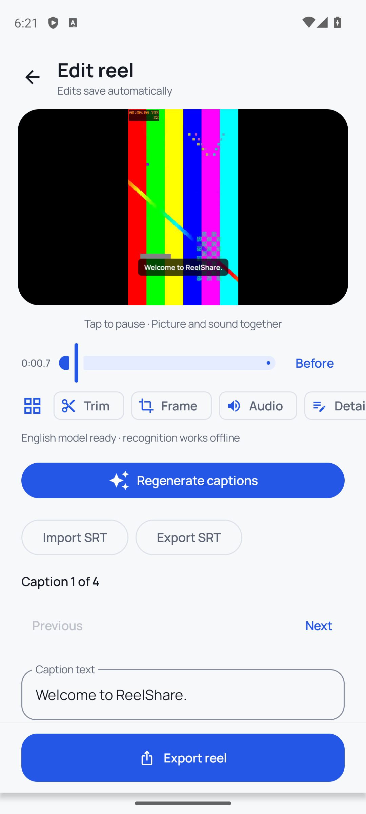 |

Screenshots use a generated QA video; no sample content is bundled in the app.

</details>

<details>
<summary>Text fonts, styles and rotation</summary>

| Light | Dark |
| --- | --- |
| 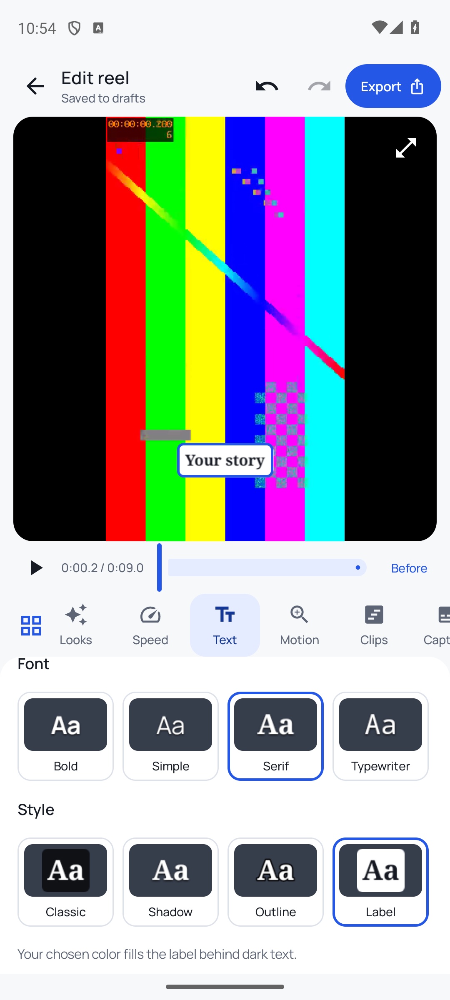 | 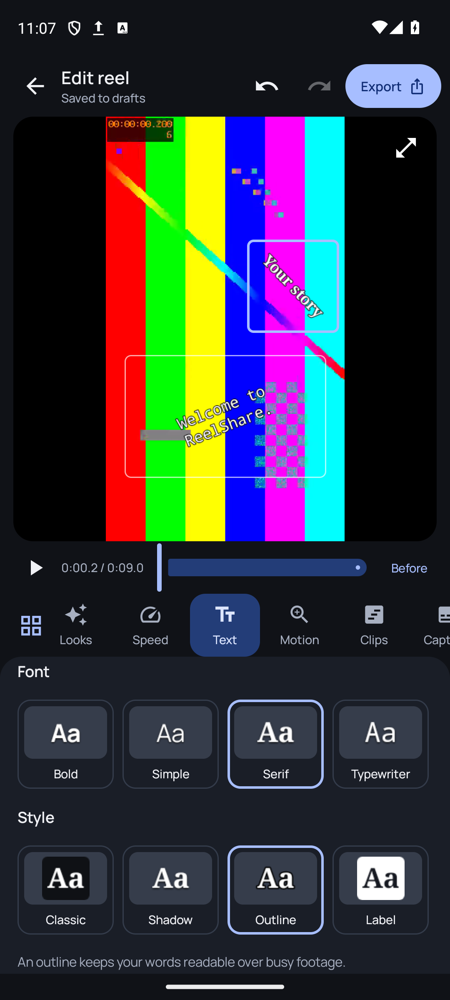 |

The samples use the same rasterizer as preview and export. Dragging a rotated title keeps its whole bounding box inside the frame.

</details>

<details>
<summary>Visual looks and motion guidance</summary>

| Video-thumbnail looks | Motion guide | R launch animation |
| --- | --- | --- |
| 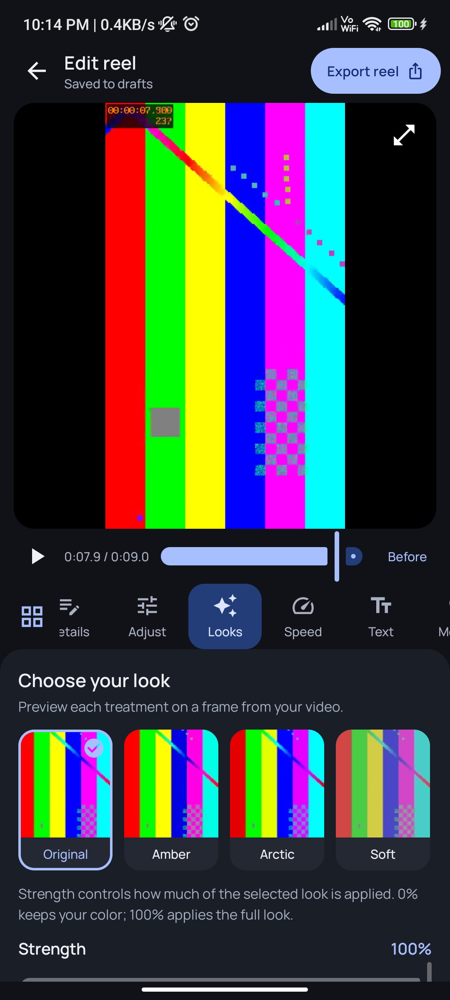 | 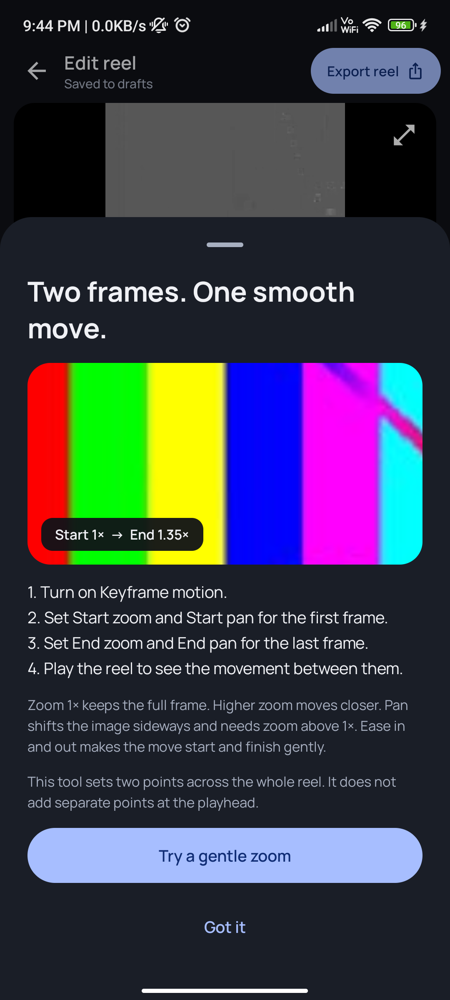 | 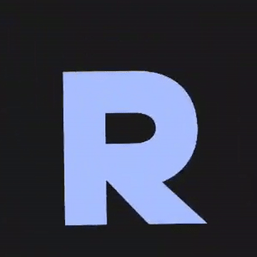 |

Filter swatches are small representative SDR thumbnails. The main video preview shows the actual Media3 treatment.

</details>

<details>
<summary>Video layouts · light and dark</summary>

| Light | Dark |
| --- | --- |
| 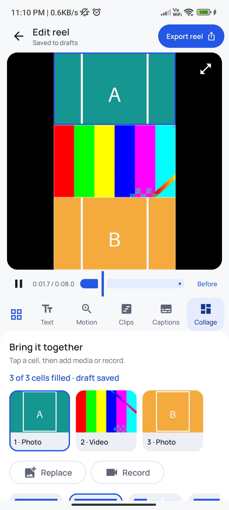 | 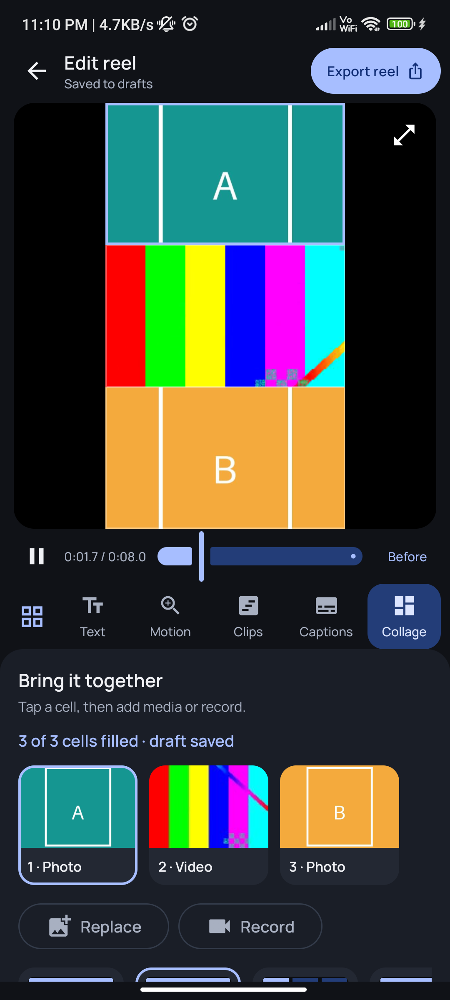 |

Generated photos and video are used for these screenshots.

</details>

## Storage and recovery

| Data | Location |
| --- | --- |
| Draft decisions, status, profile, appearance and file references | Private Room database |
| Imported audio/video sound source and artwork | Private `files/studio/<draft-id>/music_<id>/` |
| Committed voiceover takes | Private `files/studio/<draft-id>/layer_<id>/` |
| Uncommitted microphone capture | Private `cache/voiceovers/` (discarded after copy; next recording removes interrupted captures) |
| Imported original and cover | Private `files/studio/<draft-id>/` |
| Additional timeline clips | Private `files/studio/<draft-id>/clip_<id>/` |
| Optional caption models | Private `no_backup/caption_models/` |
| Edited preview | Private `cache/renders/` |
| Profile photo | Private `files/profile/` |
| Explicitly saved output | Public `Download/ReelShare/` |

Android may evict cache. Open the draft and recreate its preview; the private original and edit decisions are retained. Removed or undone clip imports and voiceover takes remain private until the draft is deleted, so undo/redo can restore them without copying media again. Replacing a collage cell or changing/removing the music source resets history before obsolete media is deleted. Undo changes edit decisions; it does not remove public downloads.

Deleting a draft removes its private originals/covers/music/render and leaves public downloads intact. Uninstalling removes private drafts and profile data. Automatic cloud backup is disabled.

Microphone permission is requested only when starting a voiceover. Recording stays in the foreground; leaving the app stops it. Android 10+ uses MediaStore with pending files during copying. Android 8/9 requests storage permission only when downloading. Notification permission is optional on Android 13+: export still works when denied, with in-app progress/cancellation.

## Architecture

- `app`: application, launch theme and studio entry point.
- `feature/creator`: Compose screens, Hilt ViewModel, MP4 validation, export policy and cancellable Media3 worker.
- `core/database`: Room entities, DAO, explicit migrations and schema snapshots. Legacy tables remain solely to preserve upgrade compatibility.
- `core/model`, `core/designsystem`: shared models and UI primitives.

File inspection/copying, thumbnails and storage writes run away from the UI thread. Only Media3 orchestration and player controls use the main looper; codec and graphics processing use Media3's internal threads. The preview player is released during export/caption generation and on leaving its screen. Editor playback seeks to zero at end rather than using a cumulative loop clock, keeping timed overlays aligned. No FFmpeg or custom C++ editing pipeline is bundled. Vosk and JNA ship native speech-recognition libraries; 64-bit binaries have 16 KB ELF segment alignment. Models load only during caption generation, with a free-memory check.

## Build and verify

Install Android SDK 37 and JDK 21 (Java/Kotlin bytecode targets 17), then open in Android Studio. Minimum Android version: 8.0 / API 26.

```powershell
.\gradlew.bat :app:assembleDebug testDebugUnitTest
.\gradlew.bat :core:database:connectedDebugAndroidTest :feature:creator:connectedDebugAndroidTest
.\gradlew.bat :app:assembleRelease :app:bundleRelease :app:lintRelease :feature:creator:testDebugUnitTest
```

Debug APK: `app/build/outputs/apk/debug/app-debug.apk`.

To inspect a built APK with the optional PC-side REA/JADX tools, run `powershell -ExecutionPolicy Bypass -File tools/inspect-apk-with-rea.ps1`. Add `-Build` to assemble the debug APK first, or `-Apk <path>` to inspect a specific ReelShare APK. The script checks the APK's package name and SHA-256 against REA's result and saves the full evidence under ignored `build/reports/rea/`. REA and JADX are development tools; neither is included in the Android app. Install `rea-agents` and configure its JADX provider on your PC before running the script.
Release APK and AAB are generated under `app/build/outputs/`. They remain **unsigned** unless all four `REELSHARE_UPLOAD_*` environment variables are set in the Gradle process:

| Variable | Value |
| --- | --- |
| `REELSHARE_UPLOAD_STORE_FILE` | Absolute path to a private upload keystore outside the repository |
| `REELSHARE_UPLOAD_STORE_PASSWORD` | Keystore password |
| `REELSHARE_UPLOAD_KEY_ALIAS` | Upload key alias |
| `REELSHARE_UPLOAD_KEY_PASSWORD` | Upload key password |

Create and back up an upload key using [Android's app signing guide](https://developer.android.com/studio/publish/app-signing). Keep the keystore and passwords out of Git; configure local ignore rules for `.jks`, `.keystore`, and `.p12` files in every clone because this repository does not track `.gitignore`. A partial signing setup fails the build. Set the variables in the terminal that runs Gradle, build `:app:bundleRelease --no-configuration-cache` so passwords are not saved in Gradle's configuration cache, then verify the resulting AAB signature before uploading it. The current unsigned artifacts must not be uploaded to Play Console.

Core versions: AGP 9.4.1, Gradle 9.6.1, Kotlin/Compose compiler plugin 2.4.21, Compose BOM 2026.09.00, Hilt 2.60.1, Room 2.8.5, Media3 1.11.1, WorkManager 2.12.0, Lifecycle 2.11.0. AGP's built-in Kotlin support is enabled. See `gradle/libs.versions.toml` for the complete pinned catalog.

Detailed device verification and research notes are kept locally by the maintainer.

## Scope and limitations

This is an offline studio with a first implementation of the tools above. It does not yet offer arbitrary keyframe tracks, overlapping video layers, cross-dissolve transitions, optical-flow slow motion, masks/background removal, beat detection, cloud templates, speech-aware ducking, imported sound-effect layers or custom in-app camera effects. It is not full CapCut parity. Market readiness needs broader device and creator testing.

Automatic captions support English and Hindi, require an initial model download, and can be inaccurate, especially with music, code-switching or unclear speech. Recognition uses original clip speech and the current trim/speed/order; generate again after timing edits. If memory is low, caption generation asks the user to close other apps or import SRT instead. First-use download uses the current connection after an explicit confirmation. Downloads can be cancelled; interrupted partial installation is cleaned and retried from the start. There is no audio/video upload.

Transitions pass through a solid color, without overlapping the videos; sound remains continuous. Motion has start/end zoom and horizontal pan, not an arbitrary keyframe timeline. Filters apply to the whole project. Text/caption timing uses the final output clock. Export settings derive from the primary source; mixed-resolution timeline clips may be scaled to that canvas. Frame positioning defaults to the ordinary reel crop, with an optional override per clip; collage cells have separate crop controls.

Online/trending music and Instagram link downloading are not implemented. Local audio import does not grant redistribution rights to copyrighted music. Details → notes remain metadata; Text and Captions are burned into the video.

The manifest locks phones to portrait. Android 16/17 can ignore orientation requests on large screens; the app bounds its workspace width instead of relying on a universal orientation lock.

Manrope is distributed under the SIL Open Font License; its license is included in the repository and APK.

Compression size is approximate and can exceed the size of an already compressed source. Hardware support, heat, storage and OS background limits affect export success. Failed exports retain the draft and show an error. A 15-minute timeout bounds a stalled job. Testing cannot guarantee zero crashes or ANRs across every device.

## Project authorship

Developed with AI assistance. Review the code and be able to explain its storage, lifecycle, migration and export decisions when presenting it as a resume project. An exact AI-authorship percentage is not measurable from this repository; this project does not claim one.

Vosk, JNA and the optional English/Hindi models are distributed under Apache 2.0 terms; notices and license texts are in `feature/creator/src/main/assets/licenses/` and included in the APK.
